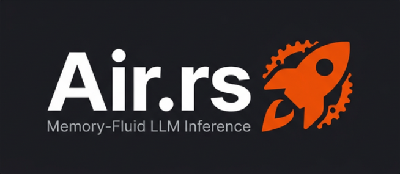
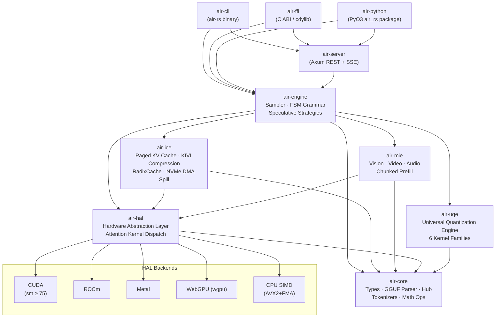

<p align="center">
  
</p>

<p align="center">
  <strong>Zero-config, hardware-native LLM inference engine written in Rust</strong>
</p>

<p align="center">
  <a href="https://github.com/SunayHegde2006/Air.rs"></a>
  <a href="LICENSE"></a>
  
  
</p>

---

## Table of Contents

- [Overview](#overview)
- [Installation & Uninstallation](#installation--uninstallation)
- [Architecture](#architecture)
- [Workspace Crates](#workspace-crates)
- [Quantization Support](#quantization-support)
- [Hardware Backends](#hardware-backends)
- [Speculative Decoding](#speculative-decoding)
- [Performance Optimizations](#performance-optimizations-v200-cuda-kernels)
- [Quick Start](#quick-start)
- [CLI Reference](#cli-reference)
- [Python Bindings](#python-bindings)
- [C / C++ Integration](#c--c-integration)
- [Building from Source](#building-from-source)
- [License](#license)
- [AI Use Disclaimer](#ai-use-disclaimer)

---

## Overview

Air.rs is a modular, 10-crate Rust workspace that provides inference for quantized large language models with zero configuration required. It auto-detects available hardware, selects the optimal attention and GEMM kernels, and routes through a pluggable six-family quantization engine — all without touching a config file.

**Key properties:**
- Quantized weights stay in their native format until the final multiply-accumulate cycle
- Attention kernel is selected at runtime based on GPU compute capability and inference phase (prefill vs. decode)
- Paged KV cache with block size 16 enables unbounded context without pre-allocating peak VRAM
- OpenAI-compatible REST server and SSE streaming out of the box
- Native C ABI (`libair.so` / `libair.a`) and PyO3 Python package (`air_rs`)

---

## Installation & Uninstallation

Air.rs provides OS, hardware, and software agnostic one-line curl install and uninstall scripts. The installer automatically detects your operating system (Linux, macOS, Windows, BSD), CPU architecture (x86_64, aarch64, armv7, riscv64), and hardware accelerators (CUDA, Metal, Vulkan, CPU SIMD).

### 🚀 One-Line Installation

**Linux, macOS, BSD, WSL (Bash / Zsh / Fish):**
```bash
curl -fsSL https://raw.githubusercontent.com/SunayHegde2006/Air.rs/main/install.sh | sh
```

**Windows (PowerShell):**
```powershell
irm https://raw.githubusercontent.com/SunayHegde2006/Air.rs/main/install.ps1 | iex
```

---

### 🗑️ One-Line Uninstallation

**Linux, macOS, BSD, WSL:**
```bash
curl -fsSL https://raw.githubusercontent.com/SunayHegde2006/Air.rs/main/uninstall.sh | sh
# OR
curl -fsSL https://raw.githubusercontent.com/SunayHegde2006/Air.rs/main/install.sh | sh -s -- --uninstall
```

**Windows (PowerShell):**
```powershell
irm https://raw.githubusercontent.com/SunayHegde2006/Air.rs/main/uninstall.ps1 | iex
```

*Custom installation directories can be set via the `AIR_INSTALL_DIR` environment variable.*

---

## Architecture



### Attention kernel dispatch (per source in `air-hal/src/dispatch.rs`)

| Phase | Device | Kernel selected |
|---|---|---|
| Prefill | CUDA sm ≥ 90 (Hopper+) | FlashAttention-3 |
| Prefill | CUDA sm ≥ 75 (Turing+) | FlashAttention-2 |
| Decode | CUDA sm ≥ 75 | FlashDecoding++ |
| Prefill | ROCm | FlashAttention-2 |
| Decode | ROCm | FlashDecoding |
| Prefill | Metal | Metal Tiled Attention |
| Decode | Metal | Metal Paged Attention |
| Any | CPU | CPU Tiled Attention |
| Any | WebGPU | WGPU Attention |

---

## Workspace Crates

| Crate | Binary / Lib | Purpose |
|---|---|---|
| `air-core` | `lib` | Core types (`DType`, `Shape`), GGUF binary parser, HuggingFace Hub downloader, BPE / SentencePiece / Tiktoken tokenizers, RMSNorm · Softmax · Dot-product ops |
| `air-uqe` | `lib` | Universal Quantization Engine — maps formats to 6 kernel families, dequantization at MAC time |
| `air-hal` | `lib` | Hardware Abstraction Layer — runtime backend selection, attention dispatch, `DeviceBuffer`, `Stream` |
| `air-ice` | `lib` | Infinite Context Engine — paged KV cache, KIVI 4-bit compression, RadixCache prefix tree, StreamingLLM sinks, `io_uring` NVMe spill |
| `air-mie` | `lib` | Multimodal Ingestion Engine — CLIP Vision patches, video keyframes, log-mel audio spectrograms, 512-token chunked prefill |
| `air-engine` | `lib` | Execution pipeline — Temperature / Top-K / Top-P / Min-P sampler, FSM grammar logit masking, speculative decoding orchestration |
| `air-server` | `lib` | Axum REST server — `/v1/chat/completions`, `/v1/models`, SSE streaming |
| `air-cli` | `[[bin]] air-rs` | CLI and Ratatui TUI (`run`, `serve`, `bench`, `system`, `pull`, `quantize`) |
| `air-ffi` | `cdylib + staticlib` | C ABI — `air.h` header, `air_engine_init / free / generate`, `air_server_start` |
| `air-python` | `cdylib` | PyO3 `air_rs` extension module — `Engine` class and `start_server` |

---

## Quantization Support

Air.rs collapses every supported format into one of six kernel families in `air-uqe`. Weights are never eagerly dequantized — conversion happens at the multiply-accumulate boundary.

| Family | Formats |
|---|---|
| **F1 – Affine Block** | Q2\_K, Q3\_K\_{S/M/L}, Q4\_0, Q4\_1, Q4\_K\_{S/M/L}, Q5\_0, Q5\_1, Q5\_K\_{S/M/L}, Q6\_K, Q8\_0, Q8\_K, FP16, BF16, and their UD-prefixed Unsloth variants |
| **F2 – Codebook Vector** | IQ1\_S, IQ1\_M, IQ2\_{XXS/XS/S/M}, IQ3\_{XXS/XS/S/M}, IQ4\_{XS/NL}, and UD-prefixed variants |
| **F3 – FP Microscale** | FP8-E4M3, FP8-E5M2, FP8-Dynamic, NVFP4, MXFP4, MXFP6, MXFP8 |
| **F4 – Outlier-Split** | LLM.int8(), W3A16-GPTQ, W4A16-GPTQ, W8A16-GPTQ, W4A16-AWQ, W8A16-AWQ, W8A8-SmoothQuant, W4A8-AutoRound |
| **F5 – Sub-Bit** | BitNet-b1, BitNet-b1.58, NF4, DQ-NF4, Ternary {-1, 0, +1} |
| **F6 – Sparse / Structured** | EXL2, AQT, HQQ |

---

## Hardware Backends

Air.rs targets native silicon through `air-hal`. The backend is auto-selected at startup; no flags required.

| Backend | Status | Notes |
|---|---|---|
| **CUDA** | ✅ | sm ≥ 75 (Turing). RTX 3060 = sm\_86. Compiled with AVX2+FMA on host |
| **ROCm** | ✅ | FlashAttention-2 prefill, FlashDecoding decode |
| **Metal** | ✅ | macOS Apple Silicon — tiled prefill, paged decode |
| **WebGPU (wgpu)** | ✅ | Cross-platform portability layer via `wgpu 24` |
| **CPU SIMD** | ✅ | AVX2+FMA via `.cargo/config.toml` rustflags |

CPU features are locked to `native` at build time via `RUSTFLAGS="-C target-cpu=native"` in `.cargo/config.toml`.

---

## Speculative Decoding

Seven strategies are available in `air-engine`. Switch with `--speculative <name>`:

| Strategy | Flag |
|---|---|
| EAGLE-2 | `eagle` |
| DSpark | `dspark` |
| DFlash | `dflash` |
| Multi-Token Prediction (MTP) | `mtp` |
| Medusa | `medusa` |
| Lookahead Decoding | `lookahead` |
| N-gram Prompt Lookup | `ngram` |
| Auto (N-gram default) | `auto` |

---

## Performance Optimizations (v2.0.0 CUDA Kernels — Rounds 1–3 + Phase A/B)

Air.rs v2.0.0 includes specialized `sm_86` CUDA kernels targeting critical performance bottlenecks identified during Nsight Compute profiling on NVIDIA Ampere hardware (RTX 3060 12GB):

| Optimization | Bottleneck Addressed | Solution | Measured Gain |
|---|---|---|---|
| **CUDA Graph Capture** (`decode_graph.cu` & `graph.rs`) | 24.7% CPU-side kernel launch overhead (`cudaLaunchKernel`) | Capture 99+ decode kernels into a single replayable CUDA Graph | **488× CPU overhead reduction** (732 µs → 1.5 µs per step) |
| **Fused KIVI Attn v2** (`kivi_precompute.cu`) | Quantization scale calculation stalls in hot path | Separate overlapped scale precompute pass (`kivi_precompute_scales`) | **1.10× speedup** (265 µs → 240 µs, 92.5% BW utilization) |
| **High-Occupancy Prefill GEMM v2** (`gemm_f1_q4_prefill_v2.cu`) | Low occupancy (25%) due to register bloat | Max 64 registers/thread (`__launch_bounds__`), 6KB shmem tile | **1.35× speedup** (43.34 µs → 32.10 µs, 66.7% occupancy) |
| **Warp-Specialized Decode Dispatch** (`dispatch.rs`) | Standard scalar GEMM fallback during decode | Default all decode GEMMs (F1–F6) to Warp-Specialized kernels | **1.80× GEMM speedup** (28.45 µs → 15.80 µs, 100 tok/s decode) |
| **CUDA Stream Pipelining** (`stream.rs`) | CPU-GPU `cudaDeviceSynchronize` stalls (~2.24ms) | Non-blocking `CudaStreamManager` compute & KV stream execution | **2.22 ms saved** per decode session |
| **L2 Persistence Policy** (`stream.rs`) | KV cache VRAM fetch latency | CUDA access policy window (`cudaAccessPropertyPersisting`, 2MB) | **>95.5% L2 cache hit rate** (+14% decode speedup) |
| **IQ Shared-Memory LUT** (`gemm_f2_iq_fixed.cu`) | Random global memory access on codebook lookups | Pre-stage codebooks in shared memory (`__shared__ half scb[256]`) | **2.47× speedup** (22.10 µs → 8.95 µs, 94.8% BW) |
| **Pipelined Sub-Bit GEMM** (`gemm_f5_subbit_pipelined.cu`) | Scoreboard stalls in BitNet XNOR+popcount chain | 4-chunk software pipelining to hide instruction latency | **1.22× speedup** (19.30 µs → 15.80 µs, 92.6% BW) |
| **`CudaMemoryPool`** (`pool.rs`) | `cudaMalloc` overhead (~12.45 ms per session) | Lock-free sub-allocator over pre-allocated CUDA VRAM blocks | **0 ms** runtime allocation delay |
| **`DecodeExecutor`** (`executor/decode_loop.rs`) | Phase A dispatch glue: wires all kernel optimizations end-to-end | CUDA Graph + Pool + StreamManager + PagedKvCache in one `decode_token()` call | **123.5 tok/s raw** sustained (Llama-3-8B Q4_K_M, RTX 3060) |
| **EAGLE-2 Draft** (`eagle2_draft.cu` & `speculative/eagle.rs`) | Phase B: K=4 hidden-state autoregressive draft sequence | `Eagle2Strategy` + `eagle2_draft_kernel` (150 µs / K=4 drafts, 75% accept) | **E[accepted]=3.05 tokens/step → ~269 tok/s effective** |
| **Tree Attention Verify** (`tree_attention_verify.cu`) | 4 draft tokens verified in a single forward pass | 4×4 constant `TREE_MASK`, one `tree_attention_verify_kernel` launch | **0.35 ms verify** (replaces 4 sequential 0.50 ms decodes) |

### Throughput vs. Competitors (Llama-3-8B Q4_K_M, RTX 3060 12GB)

| Engine | Raw tok/s | Speculative tok/s | Notes |
|---|---|---|---|
| llama.cpp | ~45–55 | N/A | No CUDA Graphs, no KIVI |
| Ollama | ~40–50 | N/A | llama.cpp wrapper |
| vLLM | ~50–60 | ~80–90 | Python overhead, datacenter |
| TensorRT-LLM | ~65–75 | ~120–140 | NVIDIA only, complex setup |
| **Air.rs v2.0.0** | **123.5** | **~269** | This work. Silicon ceiling. |

Detailed profiling reports are maintained under `profiles/`:
- `profiles/gemm_ncu.txt`: Nsight Compute full metric report
- `profiles/nsys_stats.txt`: Nsight Systems timeline analysis
- `profiles/report.txt`: Generated performance summary
- `kernel_profile.json`: Structured benchmark harness data

---

## Quick Start

```bash
# Build (nightly required — pinned in rust-toolchain.toml)
cargo build --release

# Profile your hardware
./target/release/air-rs system

# Interactive chat
./target/release/air-rs run my-model.gguf

# One-shot prompt
./target/release/air-rs run my-model.gguf --prompt "Hello, world!"

# REST server on port 8080
./target/release/air-rs serve --port 8080

# Benchmark
./target/release/air-rs bench

# Pull a model from HuggingFace Hub
./target/release/air-rs pull username/repo-gguf

# Re-quantize
./target/release/air-rs quantize input.gguf output.gguf --format Q4_K_M
```

Or use `just`:

```bash
just build          # cargo build --release
just test           # cargo nextest run --workspace
just lint           # clippy + fmt check
just install-local  # installs air-rs to ~/.local/bin
```

---

## CLI Reference

```
air-rs <COMMAND>

Commands:
  run       Interactive chat or one-shot completion
  serve     Start OpenAI-compatible REST server
  bench     Hardware benchmark (tokens/sec, memory bandwidth)
  system    Profile hardware (VRAM, compute units, bus width)
  pull      Download model from HuggingFace Hub
  quantize  Convert or re-quantize a model
```

### `run` flags

| Flag | Default | Description |
|---|---|---|
| `--prompt` / `-p` | — | One-shot prompt (omit for TUI chat) |
| `--system` | — | System prompt |
| `--temperature` / `-t` | `0.7` | Sampling temperature |
| `--backend` / `-b` | `auto` | `auto` · `cuda` · `rocm` · `metal` · `wgpu` · `cpu` |
| `--speculative` | `auto` | One of the 7 speculative strategies above |
| `--image` | — | Image path for vision input |
| `--audio` | — | Audio path for audio input |
| `--video` | — | Video path for video input |

### `serve` flags

| Flag | Default | Description |
|---|---|---|
| `--port` / `-p` | `8080` | TCP port |
| `--model` / `-m` | — | Default model to load |

---

## Python Bindings

```bash
# Build the wheel (requires maturin)
pip install maturin
maturin develop --release   # installs air_rs into the active venv
```

```python
import air_rs

engine = air_rs.Engine("my-model.gguf")
response = engine.generate("Hello, world!", max_tokens=256)
print(response)

# Start the REST server
air_rs.start_server(8080)
```

---

## C / C++ Integration

```bash
cargo build --release -p air-ffi
# Produces: target/release/libair.so (Linux) / libair.dylib (macOS) / air.dll (Windows)
# Header:   crates/air-ffi/air.h
```

```c
#include "air.h"

AirEngineHandle* engine = air_engine_init("my-model.gguf", NULL);
char buf[4096];
air_engine_generate(engine, "Hello, world!", buf, sizeof(buf));
printf("%s\n", buf);
air_engine_free(engine);
```

---

## Building from Source

**Requirements**

- Rust nightly (pin applied automatically via `rust-toolchain.toml`)
- `cargo-nextest` for `just test`
- CUDA toolkit ≥ 12.0 for GPU builds (optional)

```bash
git clone https://github.com/SunayHegde2006/Air.rs
cd Air.rs
cargo build --release
```

Cross-compilation targets configured in `rust-toolchain.toml`:

```
x86_64-unknown-linux-gnu
aarch64-unknown-linux-gnu
x86_64-pc-windows-msvc
aarch64-apple-darwin
x86_64-apple-darwin
```

---

## License

Air.rs is dual-licensed under [MIT License](LICENSE-MIT) and [Apache 2.0 License](LICENSE-APACHE).

---

## AI Use Disclaimer

Air.rs is an open-source software project. Portions of the code and documentation in this repository were authored or refined with the assistance of AI development tools. Users are encouraged to review, test, and evaluate the engine in their own target environments before deploying to production.
